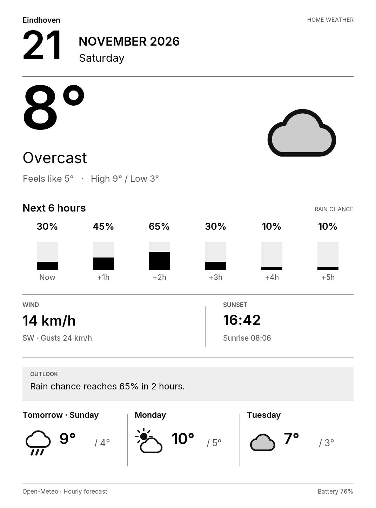

# Kindle Home Dashboard

An English, serverless home dashboard with weather and robot controls for a jailbroken **Kindle Paperwhite 3**.
Designed to hang on a refrigerator, run on battery, and refresh hourly without a
continuously ticking clock. Weather comes directly from Open-Meteo; no API key,
subscription, or always-on computer is required.

**Status:** an early device-specific project. Date, forecast, cache, installer,
launcher, and lifecycle logic have automated tests. Actual scheduled wake and
battery-life validation remain pending; see [device validation](docs/DEVICE-VALIDATION.md).

## The screen

- Large date and weekday, localized in English.
- Current temperature, feels-like temperature, today's high and low.
- Six hourly rain probabilities, wind direction, speed and gusts.
- Sunrise and sunset, a short weather outlook, and the next three days.
- Battery percentage and a visible outdated-data state.



The preview uses **example data**, rendered from the actual Lua layout through
local widget adapters. It is not a live forecast or a physical-device screenshot.

## Install or update on the Kindle

The supported target is **Paperwhite 3, firmware 5.16.2.1.1, KOReader v2026.07.1**.
The installer requires a successful jailbreak marker and an existing KOReader
installation. It never replaces the KOReader runtime.

1. Quit KOReader completely and connect the Kindle over USB.
2. On the Mac, from this folder, run a read-only preflight:

   ```bash
   python3 install.py --update --dry-run
   ```

3. Update the existing prototype, then safely eject and unplug:

   ```bash
   python3 install.py --update
   ```

4. With Wi-Fi enabled, open **Weather-Dashboard** in the Kindle library.

For a fresh installation, omit `--update`. Mac users can also use
`Install.command`, `Update.command`, or `Uninstall.command`. The installer verifies
payload hashes, backs up overwritten files to `device-backups/`, and preserves
books and annotations. The English update replaces the old Turkish-named launcher
entries while keeping internal state-file names compatible.

See [installation and recovery](docs/INSTALLATION.md) for details.

## Develop locally

Python **3.11+** is needed on the development computer. Python is **not** installed
or needed on the Kindle; device code is Lua 5.1 and shell, using KOReader.

```bash
python3 -m venv .venv
source .venv/bin/activate
python -m pip install -r requirements-dev.txt
make test
make preview
make build
```

- The preview is written to `artifacts/preview.png`.
- `make build` regenerates `manifest.json` and creates a device ZIP in `dist/`.
- `make source` also creates a portable source ZIP.
- `make check` verifies that the tracked manifest matches the payload.
- Commit the regenerated `manifest.json` with payload changes.

Both archive builds use fixed ZIP timestamps and file modes. No device backup,
local dependency environment, cache, book, runtime binary, or log is packaged.
GitHub Actions runs tests and build checks on Python 3.12 and 3.14.

## Project layout

| Path | Purpose |
| --- | --- |
| `payload/` | Editable source mirroring the Kindle filesystem |
| `install.py` | Install/update/rollback utility; Python standard library only |
| `scripts/build.py` | Payload manifest and reproducible release/source archives |
| `tests/` | Lua 5.1 logic, lifecycle, source/cache, shell and installer tests |
| `docs/` | Architecture, device validation, installation and GitHub handoff |
| `AGENTS.md` | Context and working instructions for Codex |

Start with [architecture](docs/ARCHITECTURE.md), [contributing](CONTRIBUTING.md),
and [current device validation](docs/DEVICE-VALIDATION.md).
To continue in Codex, open **this folder** as the project and read `AGENTS.md`.
To upload later, follow [the GitHub handoff](docs/GITHUB.md).

## Configuration and battery behavior

### Optional Dreamehome controls (experimental)

Version 1.2 adds **Weather** and **Vacuum** tabs. The Vacuum page contains large
**Clean all**, **Kitchen** and **Dining** buttons. The Kindle
contacts Dreamehome directly over HTTPS only when requested; no always-on Mac,
Home Assistant or bridge is required. Internet access is required. Real-device
login, TLS compatibility and cleaning remain pending validation.

Open **Weather Dashboard → Connect Dreamehome** in KOReader. Enter your account
and server region (usually `eu` for a Netherlands account), select your robot,
then create two cleaning shortcuts named exactly **Kitchen** and **Dining** in
Dreamehome with the desired rooms and vacuum/mop settings. Open the Vacuum tab.
The prototype accepts L50 Pro Ultra identifiers `dreame.vacuum.r9445a`,
`dreame.vacuum.r9445d` and `dreame.vacuum.r9445g` from the upstream model list.
Physical control remains unverified. **Find Dreamehome robot** in the menu reuses
the saved session and distinguishes an empty device list from a different model.

Buttons work on the awake dashboard. A deep-sleep screen cannot accept taps:
wake using the power button and panel mode reopens the interactive dashboard on
the last selected tab. Cached weather appears without waiting for Wi-Fi. The menu
entries **Robot controls** and **Show / hide dashboard** remain available.
On Vacuum, **Check connection** reads shortcut availability without starting
cleaning. The most recent command/check result remains visible below that button.
Switching tabs makes no network request. The sleep screen shows weather with an
explicit sleep label and wake instructions, without interactive-looking tabs;
the awake dashboard remembers its tab through forecast refreshes. Tap the weather
page outside the tab bar to dismiss the dashboard. Future tabs can be added to
`dashboard_tabs.lua` without changing the existing tab widths or hit areas.
See [Dreamehome setup and limitations](docs/DREAMEHOME.md).

`payload/koreader/plugins/weatherlockscreen.koplugin/fridge_config.lua` contains
the city, coordinates, hourly interval and minimum battery level. Defaults are
Eindhoven, metric units, a one-hour interval, and a 15% battery threshold.
`interactive_idle_seconds` defaults to 300: on battery the interactive dashboard
waits five minutes after the latest touch before sleeping (the watchdog checks
every 30 seconds). Opening a dialog, editing login fields and manual wake also
reset the deadline. The power button can still sleep the device immediately.

The date code currently supports **Europe/Amsterdam only**. Changing a timezone
string alone does not provide worldwide date/DST support.

A reversible launcher temporarily hands the sleep screen to KOReader while the
app is active. It restores the native module when KOReader exits, without changing
firmware or persistent account/ad preferences. The USB screen is left untouched.
If the wake manager cannot be initialized, automatic sleep is disabled and an
explicit diagnostic is shown. The first RTC wake is tested after roughly two
minutes; once observed, normal hourly scheduling resumes. Physical-device
confirmation is still required.

## Credits and license

AGPL-3.0-or-later. Includes modified code from
[Kindle Weather Station](https://github.com/muffism/kindle-weather-station) and
[WeatherLockscreen](https://github.com/loeffner/WeatherLockscreen).
Inter fonts retain their SIL Open Font License. Weather data is provided by
[Open-Meteo](https://open-meteo.com/) under CC BY 4.0 for this personal,
non-commercial use. Full source and attribution are in [NOTICE.md](NOTICE.md).
